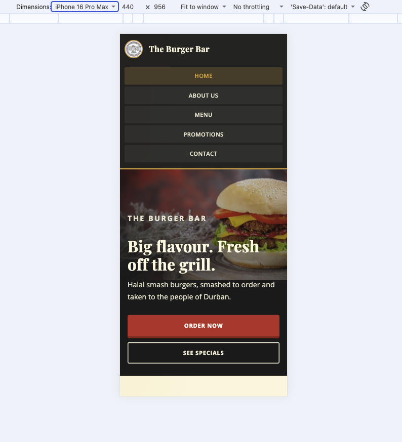
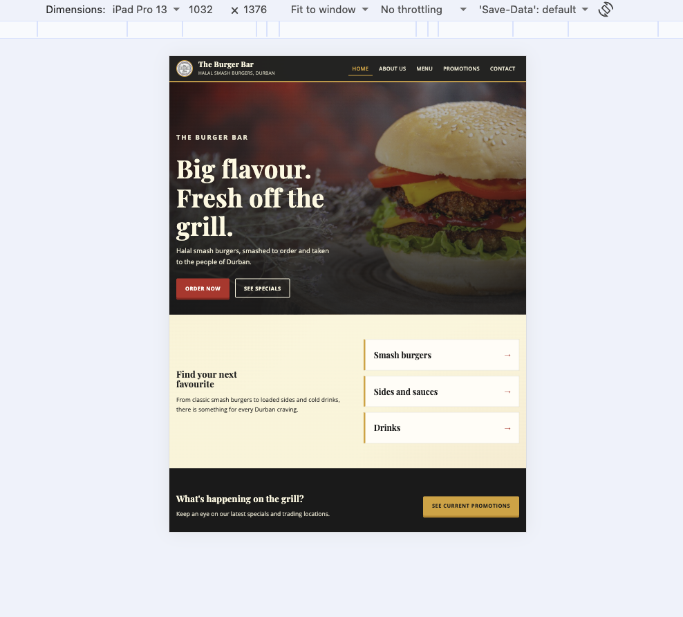
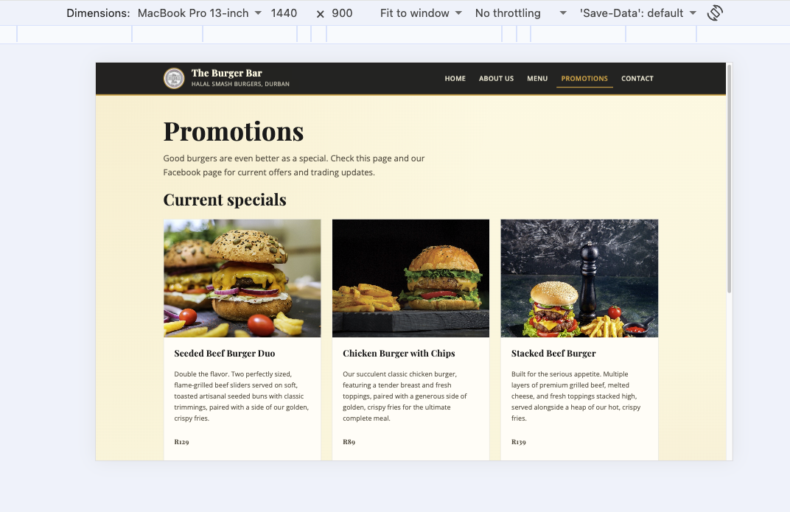

# The Burger Bar Website

## Student Information

- **Student:** Omar A. Lopes
- **Student number:** ST10546572
- **Module:** Introduction to Web Development
- **Module code:** WEDE5020w

## Project Overview

This project involves the development of a comprehensive website for The Burger Bar, a Durban-based mobile eatery specialising in American-inspired smash burgers. The website will serve as the digital presence for this local brand, which is halal and known for taking the grill to the people, including trading at 246 Currie Road in Morningside.

The Burger Bar website development project spans 12 weeks from 20 July 2026. This structured approach divides the work into three distinct phases, each building upon the previous foundation to create a comprehensive online presence for the business. Part 1 was due on 21 August 2026, Part 2 on 18 September 2026, and Part 3 was completed on 25 October 2026.

The development of this website addresses the current lack of online presence for The Burger Bar. Through research conducted on the brand's Facebook page and related public listings on 20 July 2026, comprehensive insights were gathered regarding business operations, customer needs, and website requirements. This information serves as the foundation for creating a digital platform that accurately represents the brand's values and offerings.

The website showcases The Burger Bar's commitment to serving fresh, high-quality, American-inspired smash burgers that are halal, flavourful, and made to order, while bringing a fun, high-energy food experience to Durban and surrounding communities. 

## Website Goals and Objectives

### Primary Goals
 
The website has been designed to achieve several key business objectives:

**Menu Accessibility:** Customers can view the complete menu online, providing convenient access to all available burgers, sides, and drinks without needing to rely on Facebook posts or phone calls for information.

**Online Ordering Capability:** The platform enables customers to place orders directly through the website, streamlining the ordering process.

**Enhanced Visibility:** The website increases brand awareness and online presence beyond Facebook, making The Burger Bar more discoverable to potential customers in Durban and surrounding areas.

**Promotional Platform:** Special offers are prominently featured on a dedicated Promotions page to drive sales and customer engagement.

### Key Performance Indicators

The success of the website will be measured through several metrics:

- Monthly website traffic to gauge overall reach and engagement
- Number of online orders placed through the platform
- Click-through rates on promotional banners to assess marketing effectiveness
- Bounce rate analysis to evaluate user engagement and content relevance

## Target Audience

The website specifically caters to:

- Local families and individuals residing in Durban
- Students and young adults seeking convenient food options
- Smash-burger lovers across Durban
- Halaal diners looking for trusted preparation information

## Key Features and Functionality

### Essential Pages Structure

**Homepage (index.html):** Full-bleed hero with The Burger Bar branding, short brand introduction, calls to action for ordering and specials, category shortcuts into the menu, a three-photo gallery that opens in a lightbox, and links to the enquiry, map and about pages.

**About Us (about.html):** Brand history, mission and vision, halal preparation information, and Meet the team content for owners and staff with local images that open in a lightbox.

**Menu (menu.html):** The full menu is generated by JavaScript from one data list, with a live search box, category tabs, price and name sorting, a result count, quantity fields and Add to cart forms.

**Promotions (promotions.html):** Current burger-and-chips specials with images, prices, Add to cart forms, and an Order now link.

**Enquiry (enquiry.html):** Bulk order, catering and trading-visit enquiry form that validates the input and instantly shows a cost estimate (bulk discounts, delivery fee, catering set-up fee) and whether the requested date is available.

**Contact (contact.html):** Interactive Leaflet map with four Durban trading spots, Show on map and Find my nearest spot buttons, Google Maps and Apple Maps links, an FAQ accordion, and a validated contact form that compiles the message into an email to the business.

**Checkout (order.html):** Cart review with quantity controls, collection or delivery choice with a delivery fee line, validated customer details, and an order confirmation with a reference number and estimated ready time.

### Core Functionality

**Mobile Responsiveness:** CSS media queries, relative units (`rem`, `%`), and responsive images adapt the layout across desktop, tablet, and mobile breakpoints.

**Location Integration:** Leaflet and OpenStreetMap interactive map with markers, popups and directions links, plus Geolocation API support to find the nearest trading spot.

**Communication Tools:** Contact form that validates input and opens the visitor's email app with the compiled message, an enquiry form with instant cost and availability responses, and a Facebook social link for trading updates.

**Ordering Path:** Add to cart forms on the menu and promotions pages save items to the browser's localStorage, a sticky cart bar shows the running total, and `order.html` handles quantity changes, delivery fees and the final order confirmation.

**Interactivity:** Scroll-reveal animations, a gallery lightbox with previous/next controls, an FAQ accordion, and dynamic menu search, filter and sort, all written in one plain JavaScript file (`js/script.js`).

**Search Engine Optimisation:** Descriptive title tags, meta descriptions and keywords, canonical links, Open Graph tags, structured data (JSON-LD), descriptive image file names and alt text, `robots.txt`, `sitemap.xml` and a custom `404.html`.

## Technical Implementation

The website uses HTML5 for semantic structure, one external CSS stylesheet (`css/style.css`) for visual styling and responsive design, and one external JavaScript file (`js/script.js`) for all interactivity. The JavaScript is written in plain, beginner-friendly ES6 (functions, `const`/`let`, template literals, `querySelector` and `addEventListener`) with a single-line comment above each function explaining what it does. The only external library is Leaflet (loaded from a CDN with Subresource Integrity hashes) for the interactive map.

Security measures include a Content Security Policy meta tag on every page, `escapeHtml()` applied to every piece of user text before it is placed in the page, honeypot fields on all forms to catch spam bots, `rel="noopener noreferrer"` on external links, and a `_headers` file with security headers for Netlify hosting.

Hosting is planned through Afrihost with the domain www.theburgerbardbn.co.za. For Part 3 the site is deployed free of charge on GitHub Pages (see Deployment below).

### Design system

| Token | Value | Use |
| --- | --- | --- |
| Ketchup Red | `#C62828` | Primary buttons, prices, active accents |
| Bun Cream | `#FFF8E1` | Page background |
| Mustard Gold | `#E09F3E` | Active navigation underline, gold buttons, highlights |
| Charcoal Black | `#1A1A1A` | Header, footer, body text contrast |
| Playfair Display | Google Fonts | Headings |
| Open Sans | Google Fonts | Body text, navigation, forms |

### Responsive breakpoints

| Breakpoint | Approx. width | Layout behaviour |
| --- | --- | --- |
| Desktop | above `64rem` (~1024px) | Multi-column grids (3-up menu), horizontal sticky nav |
| Tablet | `40.01rem` to `64rem` (~641px–1024px) | Two-column product grids, stacked section layouts |
| Mobile | `40rem` and below (~640px) | Single-column content, compact 2-column nav grid |
| Small phones | `30rem` and below (~480px) | Single-column navigation |

## Content Strategy

All website content has been developed through primary research, including The Burger Bar's Facebook page and related public listings accessed on 20 July 2026. Visual elements use legally sourced stock photography from Magnific, professional typography from Google Fonts, and carefully selected colour schemes from ColorHunt that reflect a grilled smash-burger experience, featuring Ketchup Red (#C62828), Bun Cream (#FFF8E1), Mustard Gold (#E09F3E), and Charcoal Black (#1A1A1A).

## Development Timeline

### Part 1: Foundation (Weeks 1-5)

**Duration:** 20 July 2026 - 21 August 2026

HTML structure, researched content, navigation, images, forms, and README documentation.

### Part 2: CSS Styling and Responsive Design (Weeks 6-9)

**Duration:** 24 August 2026 - 18 September 2026

External stylesheet, CSS reset, typography scale, Flexbox/Grid desktop layouts, hover/focus/active states, media queries, relative units, responsive images (`srcset` / `picture`), screenshot evidence, and README updates.

### Part 3: Interactivity and SEO (Weeks 10-12)

**Duration:** 21 September 2026 - 25 October 2026

JavaScript interactivity, dynamic menu, form validation and processing, interactive map, SEO improvements, security, deployment and final testing.

## File and Folder Structure

```text
the-burger-bar/
├── index.html
├── about.html
├── menu.html
├── promotions.html
├── enquiry.html
├── order.html
├── contact.html
├── 404.html                 # Custom not-found page
├── robots.txt               # Crawler rules and sitemap location
├── sitemap.xml              # XML sitemap for search engines
├── _headers                 # Security and cache headers (Netlify)
├── css/
│   └── style.css
├── js/
│   └── script.js            # The single JavaScript file for the whole site
├── images/
│   ├── responsive/          # 480w and 800w image variants for srcset
│   └── screenshots/         # Responsive testing evidence for Part 2
└── README.md
```

## Part 2 Details

Part 2 delivers the visual design and responsive behaviour for the website:

- External stylesheet `css/style.css` linked from every HTML page.
- CSS reset and shared base styles for fonts, colours, spacing, and links.
- Typography using Playfair Display (headings) and Open Sans (body), with a rem-based type scale.
- Desktop layouts built with Flexbox (header, hero actions, forms) and CSS Grid (menu products, about cards, team, contact/order split).
- Visual styling using the brand colour palette, borders, soft shadows on hover, and interactive `:hover`, `:focus`, and `:active` states on navigation, buttons, and form controls.
- Media queries for desktop, tablet, and mobile, switching multi-column layouts to single column on smaller screens.
- Relative units (`rem`, `%`) for typography, spacing, and fluid widths.
- Responsive images using `srcset`, `sizes`, and the `picture` element on key pages, with resized assets in `images/responsive/`.
- Browser developer tools and headless Chrome used to test and capture desktop, tablet, and mobile screenshots.

## Part 3 Details

Part 3 adds JavaScript interactivity, dynamic content, working forms, SEO and deployment. All project JavaScript lives in one file, `js/script.js`, which is loaded with `defer` on every page. Each section of the file checks that the elements it needs exist, so the same file works on every page.

### JavaScript interactivity

- **Dynamic menu (`menu.html`):** The 27 products are stored in a `MENU` array in `script.js` and rendered into the page with template literals. Visitors can search (every word typed must appear in the item name, description, tags or category), filter by category tabs, and sort by price or name. A live result count is announced with `aria-live`, and a Clear button resets everything.
- **Cart and checkout:** Add to cart forms on the menu and promotions pages are handled by one delegated `submit` listener. The cart is saved in `localStorage`, a sticky cart bar shows the count and total, and `order.html` renders the cart with `−` / `+` quantity controls, Remove and Clear cart buttons, a delivery fee line and a grand total.
- **Gallery lightbox:** Any image button with `data-lightbox-src` opens a `<dialog>` lightbox. Images that share a `data-lightbox-group` become one slideshow with previous/next buttons, arrow-key support and an "x of y" counter. Used on the home page gallery, every menu card, the promotions and the team photos.
- **Accordion:** The FAQ on `contact.html` uses buttons with `aria-expanded` and `aria-controls`; only one answer is open at a time and the open/close is animated with CSS.
- **Animations:** Cards fade and rise into view as they scroll into the viewport using the `IntersectionObserver` API, buttons briefly show "Added ✓", and the lightbox image fades in when loaded. All animations respect `prefers-reduced-motion`.
- **Interactive map (`contact.html`):** Leaflet 1.9.4 with OpenStreetMap tiles shows four trading spots with markers and popups. Location cards under the map have Show on map buttons that fly the map to that marker, Show all locations resets the view, and Find my nearest spot uses the Geolocation API (with permission) to find the closest trading spot and how far away it is.

### Forms

- **Validation:** Every form uses HTML5 attributes (`required`, `type="email"`, `type="tel"`, `minlength`, `maxlength`, `min`, `max`) plus JavaScript validation in `validateForm()`. Errors appear under the field, the field is marked with `aria-invalid`, a summary message counts the problems, and the first invalid field receives focus. After the first submit attempt, fields are re-checked as the visitor types. South African phone numbers are checked with a regular expression, and every form has a hidden honeypot field to catch spam bots.
- **Enquiry form (`enquiry.html`):** The item dropdown is filled from the menu data (and pre-selected when arriving from an "Enquire about a bulk order" link). As the visitor changes the quantity a live estimate appears. On submit the script calculates the subtotal, 10% or 15% bulk discount (10 or 25+ items), R250 catering set-up fee and the R35 delivery fee (free over R500), checks availability (closed Mondays, 1–5 days' notice depending on the order, large evening orders only on Fridays and Saturdays) and displays a response panel with a reference number, cost table, next steps, an "Add to cart & checkout" button and an "Email this enquiry" link.
- **Contact form (`contact.html`):** After validation the message is compiled into an email (subject, body, sender details and reference number) using a `mailto:` link to `hello@theburgerbardbn.co.za`, and a confirmation panel shows what was sent.
- **Checkout form (`order.html`):** Validates the customer details (and the address when delivery is chosen), then shows an order confirmation with a reference number, order summary, delivery fee, total and an estimated collection or delivery time based on trading hours, and empties the cart.
- **AJAX:** `sendWithAjax()` posts the form data as JSON with `fetch()` whenever a form has a `data-endpoint` attribute (for example a Formspree or Netlify Forms URL). Without an endpoint the forms fall back to the local processing and `mailto:` behaviour described above, so the site works on static hosting.

### SEO

- Unique, descriptive `<title>` tags and `meta description` and `meta keywords` on every page.
- One `<h1>` per page with a logical `h2`/`h3` hierarchy.
- Canonical links, Open Graph and Twitter Card tags, and JSON-LD `Restaurant` structured data on the home page.
- Descriptive kebab-case image file names and alt text on every image; lazy loading on images below the fold and `fetchpriority="high"` on the hero.
- Clean, readable URLs and internal links between all pages (home links grid, footer navigation, menu-to-enquiry links).
- `robots.txt` (blocks indexing of the checkout page) and `sitemap.xml` listing the six public pages; `order.html` also carries `noindex`.
- Mobile-friendly responsive layout, a skip link and `aria` attributes for accessibility.
- Page speed: a single CSS file, a single deferred JavaScript file, responsive `srcset` images and cache headers in `_headers`.

### Security

- Content Security Policy `<meta http-equiv>` on every page restricting scripts, styles, images and connections to the site itself, Google Fonts, unpkg (Leaflet) and OpenStreetMap tiles.
- All user-supplied text passes through `escapeHtml()` before it is inserted with `innerHTML`.
- Leaflet files are loaded with Subresource Integrity (`integrity` + `crossorigin`) attributes.
- External links use `rel="noopener noreferrer"`; `_headers` sets `X-Content-Type-Options`, `X-Frame-Options`, `Referrer-Policy` and `Permissions-Policy` for Netlify hosting.

## Deployment

The site is a static website, so it can be hosted free of charge on GitHub Pages or Netlify.

**GitHub Pages (used for this submission):**

1. Push the repository to GitHub.
2. Open the repository Settings → Pages.
3. Under Build and deployment choose Deploy from a branch, select the `main` branch and the `/ (root)` folder, then Save.
4. After about a minute the site is live at `https://omaralopes.github.io/WEDE5020w_POE_ST10546572/`.

The canonical links, `robots.txt` and `sitemap.xml` already use this URL. If the site is deployed on Netlify instead (drag the project folder onto app.netlify.com/drop or connect the GitHub repository), update the URL in those files and the `_headers` file will be applied automatically.

**Live site:** https://omaralopes.github.io/WEDE5020w_POE_ST10546572/

## Responsiveness Testing and Iteration Across Devices

These screenshots show how the site responds on common devices after iterative testing and adjustments.

### Mobile

**iPhone**



### Tablet

**iPad**



### Desktop

**MacBook Pro**



## Sitemap

```text
Home (index.html)
├── About Us (about.html)
├── Menu (menu.html)
│   ├── Search, category tabs and sort
│   ├── Beef burgers, chicken burgers and combo sections
│   ├── Sides section
│   └── Drinks and mocktails section
├── Promotions (promotions.html)
├── Enquiry (enquiry.html)
│   └── Bulk order / catering estimate and availability
├── Checkout (order.html)
│   ├── Cart with quantity controls
│   └── Customer details and order confirmation
└── Contact (contact.html)
	├── Interactive map of trading locations
	├── Frequently asked questions
	├── Contact form
	└── Facebook link
```

## GitHub Repository

Commits use descriptive messages, for example:

```text
Add Part 2 external stylesheet and link all pages
Implement responsive Grid and Flexbox layouts
Add single script.js with dynamic menu, cart, lightbox, forms and map
Add SEO files: robots.txt, sitemap.xml, meta tags and 404 page
Update README with Part 3 details, changelog and references
```

## Detailed Changelog

### Part 1

**v1.0 - 19 Aug 2026:** Initial commit; created five HTML pages (`index.html`, `about.html`, `menu.html`, `promotions.html`, `contact.html`); added shared navigation and footer structures; added researched Burger Bar content; added menu categories for burgers, sides, sauces and drinks; added promotions and event information; added contact details, contact form and Google Maps link; added HTML comments explaining the main page sections; created the initial `README.md`.

**v1.1 - 19 Aug 2026:** Added the project overview, goals, target audience, features, technical details, timeline, changelog and references to the README; removed the email address from the README.

**v1.2 - 19 Aug 2026:** Removed the duplicate README title; removed the Pages heading; removed the Folders heading; removed the outdated HTML foundation text; removed the Navigation and Testing section.

**v1.3 - 19 Aug 2026:** Pushed all changes to the GitHub repository.

**v1.4 - 19 Aug 2026:** Added local images to the `images/` folder using kebab-case file names for the logo, hero image, owners, staff, beef burgers, chicken burgers, combo, sides, drinks and mocktails.

**v1.5 - 19 Aug 2026:** Updated `menu.html` with the full beef, chicken, combo, sides, and drinks and mocktails menu; added matching image tags, descriptions and South African Rand prices.

**v1.6 - 19 Aug 2026:** Updated `promotions.html` with three burger-and-chips specials, local images, combo prices, Add to cart forms and an Order now link to `order.html`.

**v1.7 - 19 Aug 2026:** Added an embedded Google Map on `contact.html` for 246 Currie Road, Morningside, Durban, plus Open in Google Maps and Open in Apple Maps links; added a Submit button after the message field.

**v1.8 - 19 Aug 2026:** Updated `index.html` with the local hero image, a homepage tagline and an Order now link to `menu.html`.

**v1.9 - 19 Aug 2026:** Updated `about.html` to match the About Us wireframe with business history, mission, vision, halal preparation and a Meet the team section for owners Amber Smith and Abel Khan and staff, including owner and staff images.

**v1.10 - 19 Aug 2026:** Created `order.html` with customer details, menu selection, quantity, cart notes and a Submit now button.

**v1.11 - 19 Aug 2026:** Added HTML-only Add to cart forms with quantity fields on all menu products and promotional food specials; added Order now links to `order.html` on `menu.html`.

**v1.12 - 19 Aug 2026:** Removed event catering, live-station booking and annual feeding-project content from `index.html`, `about.html`, `promotions.html` and `contact.html`.

### Part 1 feedback corrections (applied during Part 2)

**v1.13 - 18 Sep 2026:** Standardised the shared header across all pages so every page now includes the logo, brand name, and consistent Durban tagline (Part 1 pages previously used inconsistent header markup, with only the homepage carrying a tagline).

**v1.14 - 18 Sep 2026:** Added the logo image to the site header on every page to strengthen brand recognition and strengthen clear Burger Bar identity in the navigation area.

**v1.15 - 18 Sep 2026:** Wrapped page content in consistent layout containers (`site-wrap`, section classes) so structural markup is ready for cascading CSS without duplicating large amounts of inline or page-specific styling.

**v1.16 - 18 Sep 2026:** Improved semantic grouping on About, Menu, Promotions, Contact and Order pages (for example product card bodies, team cards, enquiry form and contact layout) so styles can cascade from a small set of reusable class selectors.

### Part 2

**v2.0 - 18 Sep 2026:** Created external stylesheet `css/style.css` and linked it from `index.html`, `about.html`, `menu.html`, `promotions.html`, `order.html` and `contact.html`.

**v2.1 - 18 Sep 2026:** Implemented a CSS reset and base styles covering box-sizing, default margins, image behaviour, form inheritance, body typography, and brand colour tokens as CSS custom properties.

**v2.2 - 18 Sep 2026:** Applied typography styles with Google Fonts (Playfair Display for headings, Open Sans for body), including font-size scale, font-weight, line-height and letter-spacing hierarchy from H1 through body and button text.

**v2.3 - 18 Sep 2026:** Built desktop layouts with Flexbox (sticky header, brand block, hero actions, product forms) and CSS Grid (menu product grids, about cards, team grid, contact/order two-column layouts, homepage category and promo sections).

**v2.4 - 18 Sep 2026:** Added visual styling for colours, backgrounds, borders and soft hover elevation; implemented interactive `:hover`, `:focus` and `:active` states on navigation links, primary/secondary buttons, category links and form fields.

**v2.5 - 18 Sep 2026:** Implemented responsive design with media-query breakpoints for desktop, tablet and mobile; switched three-column layouts to two columns on tablet and one column on phones; adjusted navigation, font sizes and spacing for smaller screens using `rem` and `%`.

**v2.6 - 18 Sep 2026:** Generated 480w and 800w image variants in `images/responsive/` and applied `srcset`/`sizes` (and `picture` on the homepage hero) so browsers can request appropriate image resolutions.

**v2.7 - 18 Sep 2026:** Tested layouts across devices and documented responsiveness evidence in the README under Responsiveness Testing and Iteration Across Devices, using device-frame screenshots for iPhone (mobile), iPad (tablet) and MacBook Pro (desktop) stored as `images/iphone-responsiveness.png`, `images/ipad-responsiveness.png` and `images/macbook-responsiveness.png`.

**v2.8 - 18 Sep 2026:** Updated this README with Part 2 details, design system, breakpoint table, expanded changelog and refreshed references.

**v2.9 - 18 Sep 2026:** Changed Add to cart behaviour so customers stay on `menu.html` or `promotions.html` while adding items; cart items are stored locally and a sticky cart bar shows item count with Keep browsing and Checkout actions. The full checkout form on `order.html` only appears after the customer chooses Checkout when they are done adding items.

**v2.10 - 18 Sep 2026:** Updated `order.html` into a checkout page that lists cart contents, lets customers continue shopping via Add more items, and only reveals customer details once the cart has items.

**v2.11 - 18 Sep 2026:** Added quantity controls on checkout (`−`, number field and `+`) so customers can increase or reduce quantities without removing a whole line; decreasing to zero removes that item. Remove and Clear cart remain available.

**v2.12 - 18 Sep 2026:** Added cart totals: each checkout line shows a subtotal, a Cart total block shows the full amount in Rand, and the sticky cart bar on menu/promotions also shows a running total while browsing.

**v2.13 - 18 Sep 2026:** Added `js/cart.js` and linked it from `menu.html`, `promotions.html` and `order.html` to power stay-on-page cart updates, checkout quantity editing and live total calculations.

### Part 2 feedback corrections (applied during Part 3)

**v2.14 - 25 Oct 2026:** Fixed the duplicate `border-top` declaration on `.about-card` in `css/style.css` and removed the decorative coloured accent lines (header underline, card top and left borders) so cards, notes and panels use a single consistent neutral border.

**v2.15 - 25 Oct 2026:** Removed the `<base href>` tags from `about.html` and `promotions.html` that caused links and images to resolve incorrectly when the site is hosted in a sub-folder (for example GitHub Pages); all paths are now relative.

**v2.16 - 25 Oct 2026:** Cart text is now escaped with `escapeHtml()` before being inserted into the page, and cart data read from `localStorage` is checked before use, closing a cross-site scripting risk in the Part 2 cart code.

**v2.17 - 25 Oct 2026:** Standardised the navigation on every page (Home, About Us, Menu, Promotions, Enquiry, Contact), added a skip link and `id="main"` landmarks, and added footer navigation so every page links to every other page.

### Part 3

**v3.0 - 25 Oct 2026:** Consolidated all JavaScript into one file, `js/script.js`, loaded with `defer` on every page (replacing `js/cart.js`). The file is organised into plain sections (settings, helpers, menu data, cart, checkout, dynamic menu, animations, accordion, lightbox, form validation, contact form, enquiry form, checkout form, map) with a single-line comment above each function.

**v3.1 - 25 Oct 2026:** Rebuilt `menu.html` as a dynamic page: products are rendered from the `MENU` data array with live search, category tabs, price/name sorting, a result count, an empty-state message and a Clear button.

**v3.2 - 25 Oct 2026:** Added scroll-reveal animations using `IntersectionObserver`, "Added ✓" button feedback, CSS keyframe animations, and `prefers-reduced-motion` support.

**v3.3 - 25 Oct 2026:** Added a `<dialog>`-based gallery lightbox with grouped slideshows, previous/next buttons, keyboard arrows and a counter; wired it to the home page gallery, menu cards, promotion images and team photos.

**v3.4 - 25 Oct 2026:** Added an FAQ accordion to `contact.html` with `aria-expanded`/`aria-controls` and animated open/close.

**v3.5 - 25 Oct 2026:** Replaced the Google Maps iframe on `contact.html` with an interactive Leaflet/OpenStreetMap map showing four Durban trading spots, location cards with Show on map buttons, Show all locations, and Find my nearest spot using the Geolocation API.

**v3.6 - 25 Oct 2026:** Built the form validation engine (`validateForm()`, `validateField()`, `showFieldError()`) combining HTML5 attributes with JavaScript checks, inline error messages, a summary, focus management, live re-validation and honeypot spam protection.

**v3.7 - 25 Oct 2026:** Created `enquiry.html` with a bulk order/catering enquiry form that returns an instant cost estimate (bulk discounts, delivery and catering fees), checks date availability, and offers Add to cart & checkout and Email this enquiry actions.

**v3.8 - 25 Oct 2026:** Rebuilt the contact form to validate input and compile the message into a `mailto:` email addressed to the business, with a confirmation panel and character counter.

**v3.9 - 25 Oct 2026:** Rebuilt `order.html` into a full checkout with collection/delivery choice, delivery fee and grand total, customer validation, and an order confirmation with reference number and estimated ready time; added optional AJAX submission via `fetch()` when a `data-endpoint` is set.

**v3.10 - 25 Oct 2026:** Applied SEO across the site: optimised title tags, meta descriptions and keywords, canonical links, Open Graph/Twitter tags, JSON-LD structured data, improved heading hierarchy and internal linking; added `robots.txt`, `sitemap.xml` and `404.html`.

**v3.11 - 25 Oct 2026:** Added security measures: Content Security Policy meta tags on every page, Subresource Integrity on the Leaflet files, `rel="noopener noreferrer"` on external links, `noindex` on the checkout page and a Netlify `_headers` file.

**v3.12 - 25 Oct 2026:** Simplified the JavaScript for readability (plain functions, `const`/`let`, template literals, single-line comments), reduced the home page gallery to three burger photos, and removed the coloured accent lines from the design.

**v3.13 - 25 Oct 2026:** Updated the README with Part 3 details, Part 2 feedback corrections, deployment instructions, the updated sitemap and file structure, and new references; pushed all commits to GitHub and deployed on GitHub Pages.

## References

- The Burger Bar, 2026. Facebook page. Available at: https://www.facebook.com/theburgerbardbn (Accessed 20 July 2026).
- Afrihost, 2026. Domains. Available at: https://www.afrihost.com/domains (Accessed 20 July 2026).
- ColorHunt, n.d. Colour palettes for designers and artists. Available at: https://colorhunt.co (Accessed 20 July 2026).
- Google Fonts, n.d. Free fonts library. Available at: https://fonts.google.com (Accessed 20 July 2026).
- Magnific, n.d. Images. Available at: https://www.magnific.com (Accessed 20 July 2026).
- Mozilla Developer Network (MDN), n.d. Using media queries. Available at: https://developer.mozilla.org/en-US/docs/Web/CSS/CSS_media_queries/Using_media_queries (Accessed 18 September 2026).
- Mozilla Developer Network (MDN), n.d. Responsive images. Available at: https://developer.mozilla.org/en-US/docs/Learn/HTML/Multimedia_and_embedding/Responsive_images (Accessed 18 September 2026).
- Mozilla Developer Network (MDN), n.d. CSS Grid Layout. Available at: https://developer.mozilla.org/en-US/docs/Web/CSS/CSS_grid_layout (Accessed 18 September 2026).
- Mozilla Developer Network (MDN), n.d. Flexbox. Available at: https://developer.mozilla.org/en-US/docs/Learn/CSS/CSS_layout/Flexbox (Accessed 18 September 2026).
- W3C, n.d. Cascading Style Sheets. Available at: https://www.w3.org/Style/CSS/ (Accessed 18 September 2026).
- Agafonkin, V., 2023. Leaflet: an open-source JavaScript library for mobile-friendly interactive maps (version 1.9.4). Available at: https://leafletjs.com/reference.html (Accessed 25 October 2026).
- OpenStreetMap Foundation, 2026. OpenStreetMap tile usage policy and copyright. Available at: https://www.openstreetmap.org/copyright (Accessed 25 October 2026).
- Mozilla Developer Network (MDN), n.d. Client-side form validation. Available at: https://developer.mozilla.org/en-US/docs/Learn/Forms/Form_validation (Accessed 25 October 2026).
- Mozilla Developer Network (MDN), n.d. Using the Fetch API. Available at: https://developer.mozilla.org/en-US/docs/Web/API/Fetch_API/Using_Fetch (Accessed 25 October 2026).
- Mozilla Developer Network (MDN), n.d. Intersection Observer API. Available at: https://developer.mozilla.org/en-US/docs/Web/API/Intersection_Observer_API (Accessed 25 October 2026).
- Mozilla Developer Network (MDN), n.d. `<dialog>`: The Dialog element. Available at: https://developer.mozilla.org/en-US/docs/Web/HTML/Element/dialog (Accessed 25 October 2026).
- Mozilla Developer Network (MDN), n.d. Window: localStorage property. Available at: https://developer.mozilla.org/en-US/docs/Web/API/Window/localStorage (Accessed 25 October 2026).
- Mozilla Developer Network (MDN), n.d. Geolocation API. Available at: https://developer.mozilla.org/en-US/docs/Web/API/Geolocation_API (Accessed 25 October 2026).
- Mozilla Developer Network (MDN), n.d. Content Security Policy (CSP). Available at: https://developer.mozilla.org/en-US/docs/Web/HTTP/CSP (Accessed 25 October 2026).
- Google, 2026. Search Engine Optimization (SEO) Starter Guide. Available at: https://developers.google.com/search/docs/fundamentals/seo-starter-guide (Accessed 25 October 2026).
- Google, 2026. Introduction to robots.txt. Available at: https://developers.google.com/search/docs/crawling-indexing/robots/intro (Accessed 25 October 2026).
- Sitemaps.org, n.d. Sitemaps XML format. Available at: https://www.sitemaps.org/protocol.html (Accessed 25 October 2026).
- Schema.org, n.d. Restaurant. Available at: https://schema.org/Restaurant (Accessed 25 October 2026).
- W3C Web Accessibility Initiative, 2024. ARIA Authoring Practices Guide: Accordion and Tabs patterns. Available at: https://www.w3.org/WAI/ARIA/apg/patterns/ (Accessed 25 October 2026).
- GitHub, 2026. GitHub Pages documentation. Available at: https://docs.github.com/en/pages (Accessed 25 October 2026).
- Netlify, 2026. Custom headers. Available at: https://docs.netlify.com/routing/headers/ (Accessed 25 October 2026).
